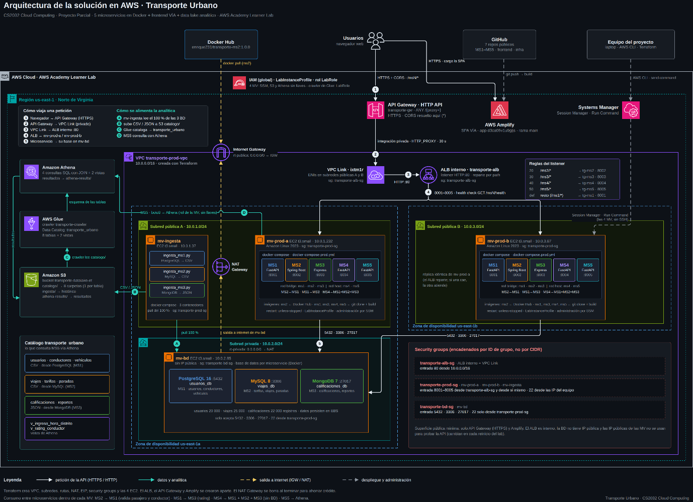
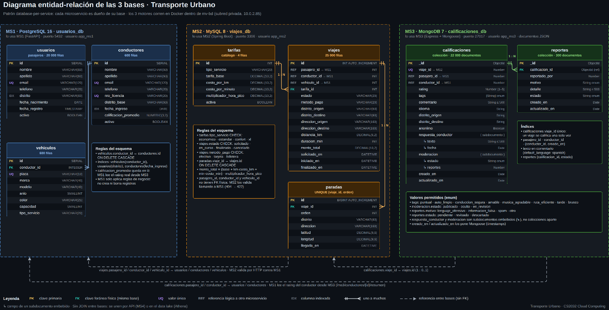
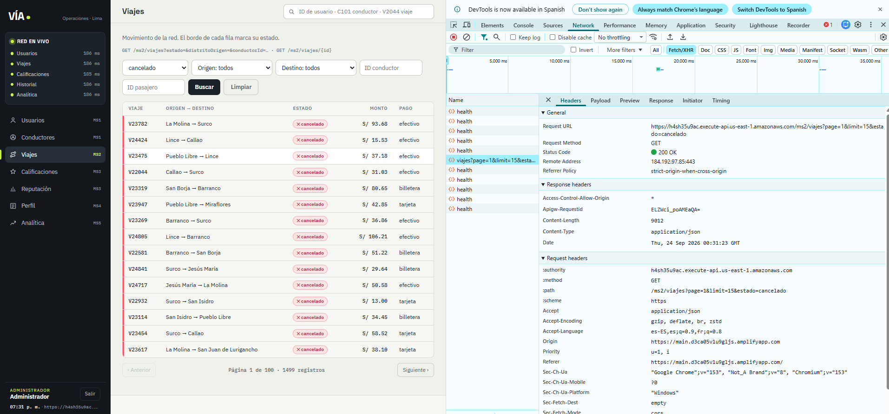
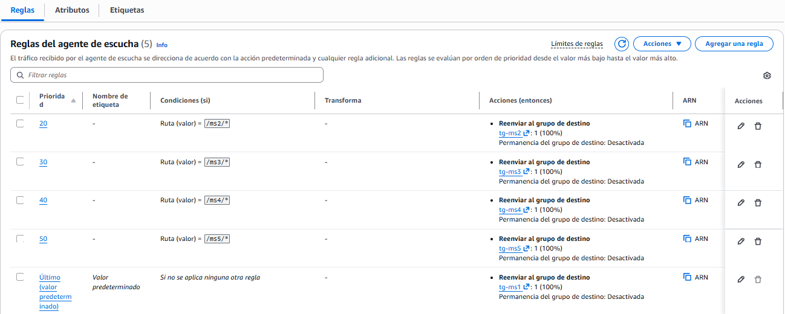
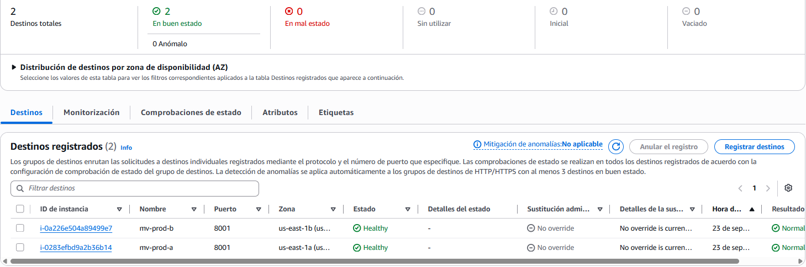
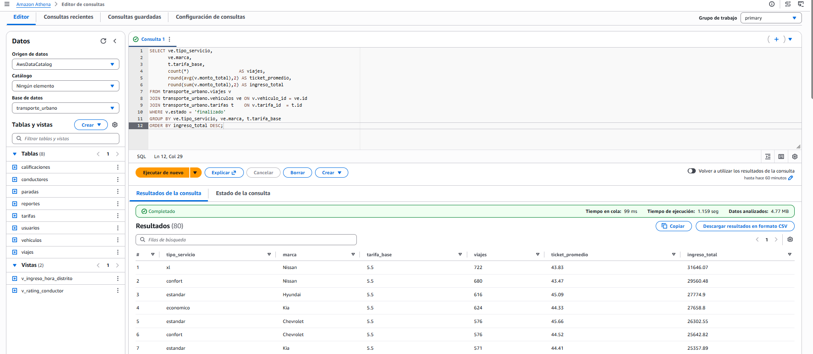
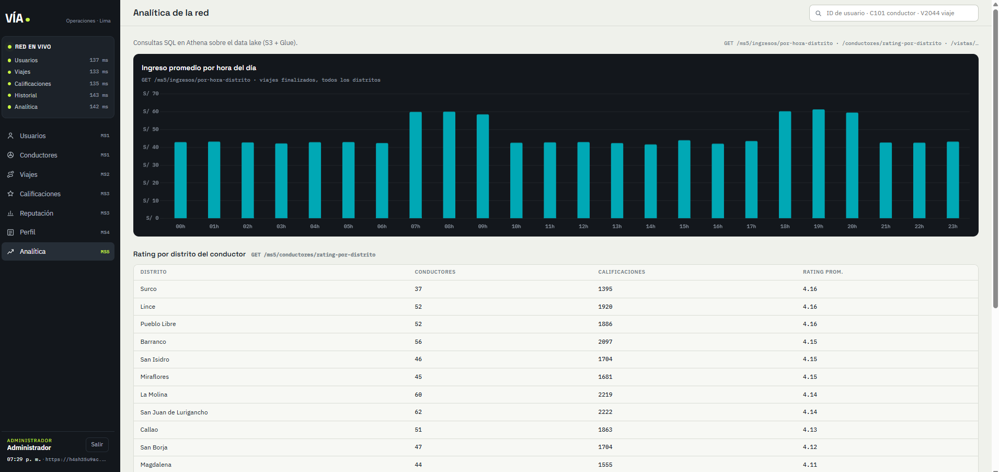

# Transporte Urbano: microservicios en AWS

Backoffice de una plataforma de transporte urbano tipo Uber o DiDi, pensado para el personal de operaciones que consulta pasajeros, conductores, viajes, calificaciones e indicadores. Está formado por 5 microservicios en Docker, un frontend web y un data lake analítico, todo desplegado en AWS.

Proyecto parcial del curso CS2032 Cloud Computing (UTEC, 2026-2), hecho en equipo de 5 personas. Este repositorio reúne la documentación del proyecto completo. El código de cada parte está en su propio repositorio (ver [Repositorios](#repositorios)).

## Demo

Video de la demo: recorrido por los endpoints de los 5 microservicios a través del API Gateway y por las consultas y vistas en Amazon Athena.

El sistema corrió en AWS Academy Learner Lab, así que las URLs públicas (API Gateway y Amplify) solo funcionan mientras el laboratorio está encendido. El video y las capturas de abajo muestran el sistema funcionando.

## Arquitectura

Recorrido de una petición:

1. El navegador carga el frontend desde AWS Amplify y llama al API Gateway por HTTPS. El API Gateway es la única entrada pública y ahí se resuelve CORS.
2. El API Gateway (HTTP API, ruta única `ANY /{proxy+}`) reenvía la petición por un VPC Link a un ALB interno.
3. El ALB reparte por ruta (`/ms1/*` a `/ms5/*`) hacia dos máquinas de producción, una en cada zona de disponibilidad (`us-east-1a` y `us-east-1b`).
4. Cada máquina corre los 5 microservicios con `docker compose`. Los health checks del ALB sacan del pool a una máquina caída.
5. Las tres bases de datos corren en una máquina dentro de una subred privada, sin IP pública. Solo aceptan tráfico del security group de producción.
6. Una máquina de ingesta copia el 100 % de las bases a S3. Un crawler de Glue arma el catálogo y Athena lo consulta. MS5 expone esas consultas como API.

## Microservicios

| MS | Responsabilidad | Stack | Base de datos |
|---|---|---|---|
| MS1 | Usuarios y conductores: reglas de negocio (elegibilidad, categoría, comisión, ranking) | FastAPI (Python) | PostgreSQL 16 |
| MS2 | Viajes, paradas y tarifas; valida pasajero y conductor contra MS1 | Spring Boot 3 (Java 17) | MySQL 8 |
| MS3 | Calificaciones, reportes y reputación del conductor | Express (Node.js) | MongoDB 7 |
| MS4 | Historial: une datos de MS1, MS2 y MS3 en una sola respuesta | FastAPI (Python) | Sin base de datos |
| MS5 | Analítica sobre el data lake | FastAPI + boto3 | Athena / Glue / S3 |
| Frontend | Backoffice "VÍA" que consume los 5 MS | HTML, CSS y JavaScript | Ninguna |

Cada microservicio es dueño de su base de datos (database-per-service). Las referencias entre bases, como `viajes.pasajero_id` hacia MS1, son lógicas y se validan por API. Las tres bases tienen datos de prueba: 20 000 usuarios, 25 000 viajes y 22 000 calificaciones.

Consumo entre servicios:

- MS1 lee de MS3 el rating real del conductor para decidir su elegibilidad y su categoría.
- MS2 valida contra MS1 que el pasajero y el conductor existan antes de crear un viaje. Si no existen, responde 422.
- MS4 combina MS1, MS2 y MS3 para armar el perfil del usuario, la hoja de vida del conductor y el detalle completo de un viaje.

Todas las llamadas entre servicios tienen timeout de 5 s y un reintento. Si el servicio remoto no responde, la respuesta sale igual con un campo de advertencias y ese bloque en `null`. La caída de un servicio no se propaga como error 500.

## Capturas

Pestaña de viajes del frontend (MS2), con la llamada al API Gateway en DevTools:

Reglas del ALB interno por ruta y destinos sanos en las dos zonas:

Consulta con JOIN en Athena sobre el catálogo de Glue, y su uso en la pestaña de analítica:

## Data lake y analítica

- La ingesta corre en 3 contenedores Python (uno por base). Exportan PostgreSQL y MySQL a CSV y MongoDB a JSON, y suben cada tabla a su propia carpeta en S3.
- Glue cataloga 8 tablas en la base `transporte_urbano`.
- En Athena hay 4 consultas con JOIN entre datos de distintos microservicios (ingreso por tipo de servicio y marca, rating por distrito, top de conductores por ingreso y satisfacción por distrito) y 2 vistas: `v_ingreso_hora_distrito` y `v_rating_conductor`.
- MS5 consulta Athena con el rol de la instancia, sin llaves de acceso en el código.

## Infraestructura y seguridad

- VPC `10.0.0.0/16` con dos subredes públicas en zonas distintas y una subred privada para las bases de datos. La base de datos sale a internet solo por un NAT Gateway.
- Security groups encadenados por ID de grupo: las bases solo aceptan tráfico de producción, y los puertos 8001 a 8005 solo aceptan tráfico del ALB.
- Terraform crea la VPC, las subredes, las rutas, el NAT, los security groups y las instancias EC2.
- Las máquinas se administran con SSM Session Manager, sin abrir el puerto 22 a internet.
- Los contenedores usan `restart: unless-stopped` y vuelven solos cuando se reinicia la máquina.

## Mi rol

Ferrel Valentino Infante García ([@S1nk0-0](https://github.com/S1nk0-0))

Estuve a cargo de:

- La distribución del trabajo en el equipo y la integración de todas las partes.
- MS2 (Viajes y Tarifas) en Spring Boot y MySQL, incluida la validación contra MS1 con timeout, reintento y respuesta 422.
- El ALB interno: reglas por ruta, target groups y health checks para las dos réplicas.

Diseñé la arquitectura junto con el equipo, co-desarrollé MS1 (reglas de negocio de usuarios y conductores) y colaboré en el API Gateway con VPC Link, en Terraform y en el data lake (S3, Glue y Athena).

## Repositorios

| Componente | Repositorio |
|---|---|
| MS1 + Terraform + colección de Postman | [Limepal/MS1-Usuarios-y-Conductores](https://github.com/Limepal/MS1-Usuarios-y-Conductores) |
| MS2 | [S1nk0-0/transporte-ms2-viajes](https://github.com/S1nk0-0/transporte-ms2-viajes) |
| MS3 | [enriquetorres-cell/transporte-ms3-calificaciones](https://github.com/enriquetorres-cell/transporte-ms3-calificaciones) |
| MS4 | [enriquetorres-cell/transporte-ms4](https://github.com/enriquetorres-cell/transporte-ms4) |
| MS5 + ingesta | [DnCuadros23/transporte-ms5-analitica](https://github.com/DnCuadros23/transporte-ms5-analitica) |
| Frontend | [enriquetorres-cell/transporte-frontend](https://github.com/enriquetorres-cell/transporte-frontend) |

## Equipo

- Alondra Solange Obregon Carhuavilca
- Denilson Jermai Cuadros Villegas
- Enrique Eusebio Torres Chafloque
- Gabriel Marcelo Diaz Carrión
- Ferrel Valentino Infante García

## Limitaciones conocidas

- Los datos de Athena son tan recientes como la última ingesta.
- Terraform no cubre el ALB, el API Gateway ni Amplify; esos se crearon desde la consola.
- Los microservicios corren con `docker compose` sobre EC2, sin un orquestador como ECS o Kubernetes.
- No hay pipeline de CI/CD: las imágenes se construyen en las máquinas.
